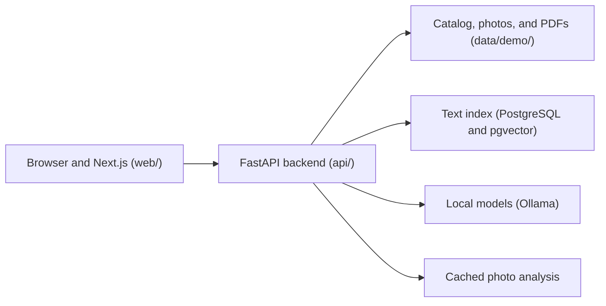

# AccessMatch Architecture

AccessMatch runs locally with a Next.js frontend, a FastAPI backend, PostgreSQL with pgvector, and models served by Ollama. The frontend sends the selected properties and criteria to the API. The API gathers evidence and returns the comparison results for display.

## Data preparation

The catalog identifies each property and its sources. During indexing, LangChain splits the PDF text into chunks of up to 800 characters, with up to 120 characters of overlap to preserve context between chunks. Ollama generates a numeric vector, called an *embedding*, for each chunk. PostgreSQL with pgvector stores the text, its embedding, and source details such as the property, document, and page.

During setup, Ollama also analyzes the photos. The application caches the visual observations for use in comparisons.

## RAG comparison workflow

1. **Request.** The `/comparar` page sends the API two property IDs and the selected criteria, such as step-free access and minimum clear width.
2. **Retrieval.** For each property with PDFs and for each evidence criterion, the API retrieves up to four chunks by vector similarity. The query uses the same embedding model as indexing and searches only the documents linked to that property.
3. **Extraction.** The API combines the retrieved chunks with the listing text and makes one text extraction call per property. This is the retrieval-augmented generation (RAG) workflow in AccessMatch. LangChain connects the search to PostgreSQL, builds the instructions for Ollama, and parses the model's response into structured JSON with fields such as measurement, unit, and quote.
4. **Validation and classification.** The API checks that each quote appears in its cited source, adds the photo observations, and applies the comparison rules. For example, a survey measurement of 78 cm meets a minimum of 75 cm. The frontend displays the result, its references, and what still needs to be confirmed.

## API routes and comparison state

| Route | Responsibility |
| --- | --- |
| `POST /comparisons` | Collects evidence, calculates the results, and returns the comparison ID. |
| `POST /comparisons/{id}/recalculate` | Reapplies the rules to new criteria using the evidence already collected. |
| `POST /comparisons/{id}/questions` | Generates questions for the advertiser based on the comparison. The user can edit and copy the text in the interface. |

The API keeps comparison evidence in memory for up to 30 minutes. The PDF index stays in PostgreSQL. If the comparison expires or the API restarts, the user must start a new analysis.

To try the workflow in the interface, see the [quick demo guide](demo.md).
